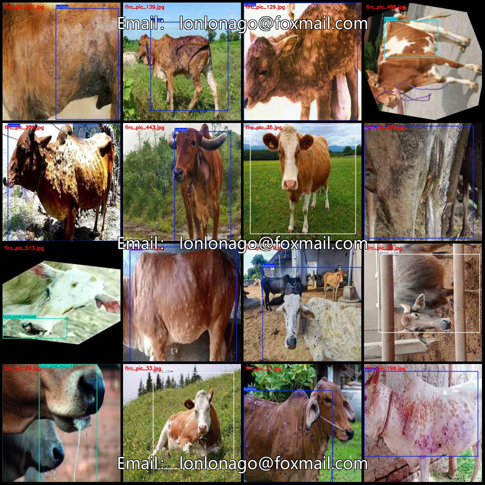
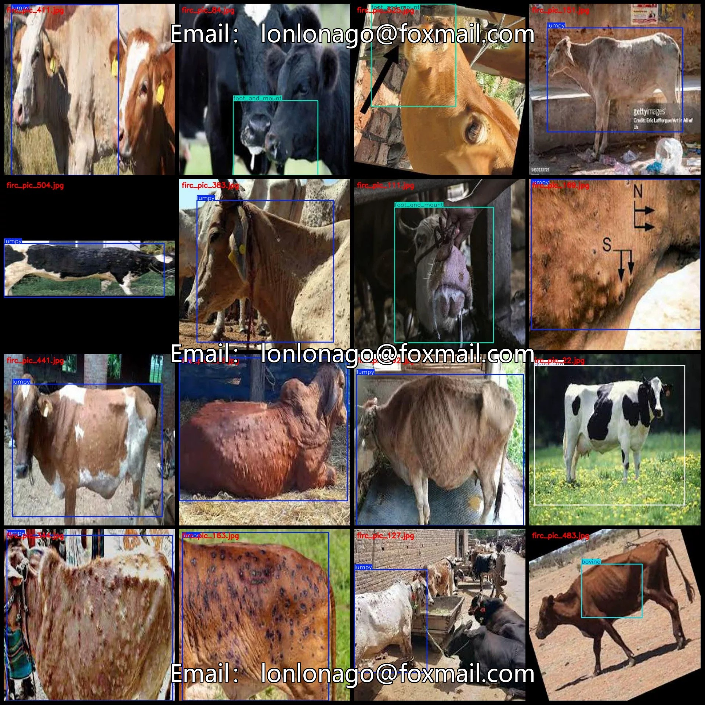
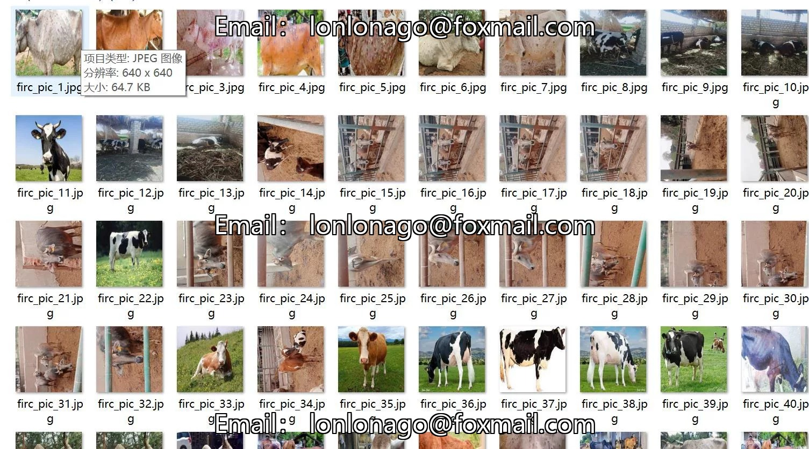
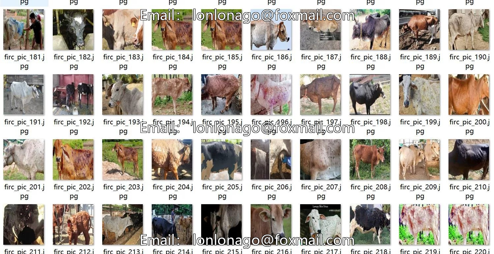

# Intelligent Dairy Beef Disease Detection Dataset VOC+YOLO format with 544 images in 6 categories

## Body

Intelligent Livestock Disease Detection Dataset - VOC+YOLO Format: 544 Images in 6 Categories
Warm Reminder: Due to the dataset's replicability, please confirm compliance with requirements before purchasing.
Dataset Format: Pascal VOC format + YOLO format (txt file without split paths, only containing jpg images and corresponding VOC format xml files and yolo format txt files)
Number of Images (Total jpg files): 544
Number of Annotations (Total xml files): 544
Number of Annotations (Total txt files): 544
Number of Annotation Categories: 6

Label category names (Note that the order of yolo format categories does not correspond to this, but is based on the classes.txt in the labels folder): ["bovine", "dermatitis", "ecthym", "foot_and_mount", "good_cow", "lumpy"]
Number of boxes and the number of images occupied by each category
bovine (Cows = 34, Number of photos held = 34
dermatitis (Psoriasis) Frame count = 1, Number of photos held = 1
Ecthym (contagious pustular dermatitis) frame count = 1, occupying picture count = 1

Foot and Mouth Disease (FMD) Frames = 90, Image Count = 88
Healthy Cow Frames = 39, Image Count = 32
Lumpiness (Bovine Tuberculosis/Pigmented Lesion) Frames = 397, Image Count = 390
Total Frames: 562
Image Resolution: 600x600
Labeling Tool: labelImg
Labeling Rules: Draw a rectangle around the category.
Important Note: The dataset does not have splits for training, validation, or testing; you will need to manually divide it.
Special Remark: This dataset does not guarantee the accuracy of the trained models or weight files.

## Images

## Payment

Here is a pay link on Stripe ( https://buy.stripe.com/3cs8yP7sY87d0vu9AB ). Please contact me lonlonago@foxmail.com after funding $89, and I will send you a complete data files , thank you!

